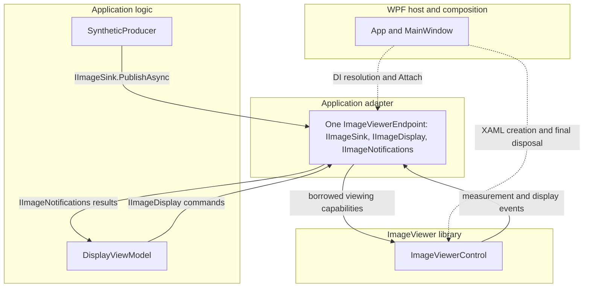

# Integrate ImageViewer through an application endpoint

[简体中文](../zh-CN/application-integration.md)

Use an application endpoint when a pipeline, plugins or a ViewModel should not know about windows, named controls or WPF image types. For a simple window, direct calls as shown in [embedding](embedding.md) and [EmbeddedViewer](../../samples/EmbeddedViewer/MainWindow.xaml.cs) are sufficient.

The [ApplicationEndpoint example](../../samples/ApplicationEndpoint/App.xaml.cs) is a standalone WPF application with synthetic Gray8 frames, two commands and length-result binding. Its endpoint, interfaces and `Attach` method belong entirely to the example application. They are not ImageViewer APIs or a required architecture for every consumer. No plugin loader or processing pipeline is needed to run it.

## Responsibilities and calls

The boxes group ownership layers; solid arrows show runtime calls or notifications, and dotted arrows show composition. The application contracts contain no WPF or ImageViewer types.



| Application contract | Purpose |
| --- | --- |
| `IImageSink` | Consume an owned `GrayFrame` asynchronously; successful completion means reception, not presentation. |
| `IImageDisplay` | Fit the image and start interactive length measurement. |
| `IImageNotifications` | Deliver an application `LengthResult` and display failure messages. |

`GrayFrame` contains width, height, stride and an `IMemoryOwner<byte>`. `LengthResult` contains only a distance in image pixels. The adapter maps completed built-in length measurements to this result; it does not expose measurement handles, WPF points or library snapshots. Starting a measurement activates a tool; it does not await the user's clicks. Escape cancels creation without a completed result. Edits to an already completed measurement are outside this minimal result contract.

## Register one endpoint under narrow interfaces

The application uses `Microsoft.Extensions.DependencyInjection` without a hosted-service or MVVM framework. [App.BuildServices](../../samples/ApplicationEndpoint/App.xaml.cs) registers one endpoint and maps each interface to it:

```csharp
services.AddSingleton<ImageViewerEndpoint>();
services.AddSingleton<IImageSink>(
    sp => sp.GetRequiredService<ImageViewerEndpoint>());
services.AddSingleton<IImageDisplay>(
    sp => sp.GetRequiredService<ImageViewerEndpoint>());
services.AddSingleton<IImageNotifications>(
    sp => sp.GetRequiredService<ImageViewerEndpoint>());
services.AddSingleton<SyntheticProducer>();
services.AddSingleton<DisplayViewModel>();
```

Registering each interface with its own implementation registration would create separate instances. Here the producer receives only `IImageSink`; the ViewModel receives `IImageDisplay` and `IImageNotifications`. There is no combined business-facing interface. The container lives for this one display session; the window owns the control independently of DI.

## Connect the XAML control

[MainWindow.xaml](../../samples/ApplicationEndpoint/MainWindow.xaml) declares the control and binds buttons and status to the ViewModel:

```xml
<viewer:ImageViewerControl x:Name="ImageViewer" />
```

The composition entry in [MainWindow.xaml.cs](../../samples/ApplicationEndpoint/MainWindow.xaml.cs) connects it after `InitializeComponent()`:

```csharp
InitializeComponent();
_endpoint = provider.GetRequiredService<ImageViewerEndpoint>();
_endpoint.Attach(ImageViewer);
_viewModel = provider.GetRequiredService<DisplayViewModel>();
DataContext = _viewModel;
```

Only this View code uses the named control. The endpoint borrows `IViewerCapabilities` internally and never disposes it. The host starts the background producer after `Loaded`; fitting is requested after layout through the button. No dependency properties, control template changes or window lookup are involved.

One endpoint supports one binding. Before binding, calls fail with `InvalidOperationException`; after `StopAccepting`, they fail with the application-defined `DisplaySessionStoppedException`. Repeated attachment, attachment after stopping and detachment before stopping are rejected. Nothing waits for binding or queues commands. Temporary WPF unloading is governed by the [embedding contract](embedding.md), not an instruction to detach or rebind this endpoint.

## Transfer buffers without an adapter copy

Invoking `PublishAsync` transfers ownership immediately, including when the endpoint is unbound, stopped, cancelled or fails. The producer must never modify, reuse or dispose the input after invocation. Before invocation, the producer owns cleanup if generating a frame fails.

The synthetic producer allocates an ordinary array-backed owner for each frame and fills it directly. The adapter calls `ImageFrame.TakeOwnership` with the existing memory and `GrayFrame.Dispose` as the release callback, then submits the resulting frame. It adds no pixel copy, pool, cache, queue or asynchronous conversion job. Rendering can still require conversion or upload; this is not a promise of end-to-end zero-copy display.

| Boundary | Cleanup responsibility |
| --- | --- |
| Before calling the sink | Producer owns the buffer. |
| Unbound/stopped, cancellation before wrapping, or memory access failure | Endpoint disposes the application frame; cleanup failure is preserved with the original error. |
| `ImageFrame.TakeOwnership` invoked | The library invokes release even if descriptor validation fails. |
| `SubmitFrameAsync` invoked | The library consumes the frame on every reception outcome; the final reference releases its storage. |

The owner must allow nonblocking release on any final-releasing thread, including the UI thread. The example owner simply drops its array reference; reclamation is managed by the GC. A future pooled or native owner must respect that same release contract.

The adapter inspects both submission status and cleanup error. Cancellation becomes an `OperationCanceledException`; other rejected statuses become an operation failure. A submission error takes precedence over cancellation so cleanup failures are not hidden. Later presentation failures use the separate display notification. The producer awaits each reception; accepted work and retained frames are drained by the library's existing disposal protocol.

## Threads, results and failures

The producer runs on a background task and awaits each sink call. Binding, display commands, notification subscription and detachment run on the host UI thread. Only frame publication crosses that thread boundary in this sample. A small lock coordinates the endpoint's borrowed reference and stopping flag; it is not an additional submission queue or drainage mechanism. A publication that obtained the viewer before stopping may finish; the host awaits its producer before detaching.

ImageViewer delivers measurement and display notifications on the owning UI thread. The adapter forwards application values synchronously on that thread, so [DisplayViewModel](../../samples/ApplicationEndpoint/DisplayViewModel.cs) can update `INotifyPropertyChanged` state directly. Subscribers must remain short and must not synchronously wait on the Dispatcher. If another adapter publishes results from a worker thread, it must marshal to the UI before updating this ViewModel; that is an application responsibility.

Command exceptions update the bound status. The host observes producer failure on the UI thread, updates status and retains the fault for shutdown reporting. Display failures update status separately. Only cancellation or the specific stopped-session rejection during intentional shutdown is treated as normal producer termination; other failures remain visible.

## Close in dependency order

The window owns one shared cleanup task, used for startup failure and normal closure. It retains the window object before XAML initialization so a created control can be released even if startup does not reach `Show()`.

```mermaid
sequenceDiagram
    participant Host as WPF host
    participant VM as ViewModel
    participant Endpoint as Application endpoint
    participant Producer as Producer task
    participant Control as ImageViewerControl
    Host->>VM: Disable commands
    Host->>Endpoint: StopAccepting
    Host->>Producer: Cancel and await completion
    Note over Producer,Control: Already entered publication finishes; no application work remains
    Host->>VM: Detach result subscriptions
    Host->>Endpoint: Detach library subscriptions and borrowed reference
    Host->>Control: await DisposeAsync
    Note over Host,Control: Dispatcher remains running during library drainage
    Host->>Host: Dispose DI container, report failures, close host
```

The first `Closing` is cancelled; repeated close requests do not start another cleanup. After awaiting producer completion, the host detaches subscriptions, awaits control disposal and reports failures. It schedules final closure after the current `Closing` callback returns. No `.Wait()` or `.Result` blocks the UI. Startup and cleanup failures are shown in a dialog; a faulted producer does not prevent control disposal.

The endpoint owns no independent conversion tasks and therefore has no `DisposeAsync`, active-call counter or separate drain task. The host's known producer task and the library's disposal completion are sufficient. Detachment alone does not release the viewer. Failed control disposal is reported, not retried as a new session; the library's resource-isolation contract still applies. Any later display session needs a new endpoint and control.

## Run and validate

From the repository root:

```powershell
dotnet run --project samples/ApplicationEndpoint
dotnet test tests/ApplicationEndpoint.Tests -c Release
./scripts/Test-Samples.ps1
```

The window streams a moving grayscale pattern without a camera or GPU. Click **Fit image**, click **Measure length**, then select two endpoints; the bound status shows the length in pixels. Close while streaming to exercise asynchronous cleanup. The focused tests cover DI identity, rejection and buffer release, cancellation, failed wrapping and host cleanup. Sample builds alone do not execute WPF interaction.
