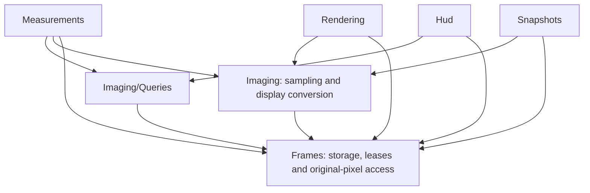

# Architecture

[简体中文](../zh-CN/architecture.md)

Use this guide when changing resource ownership or module dependencies. Standalone Viewer owns an independent WPF STA and hosts ImageViewerControl; embedded
ImageViewerControl borrows its application dispatcher. Callers submit immutable frames
and use the shared capabilities, drawing handles and measurement handles.

## Source organization

Managed library projects live under `src/`: the core in `src/Fizzy.ImageViewer/`
and the optional CUDA backend in `src/Fizzy.ImageViewer.Cuda/`. The feature paths
below are relative to the core project, except `native/Cuda`, which is repository-relative.

| Directory | Responsibility |
| --- | --- |
| Viewer | Public facade, embedded control, runtime composition, window host and lifetime |
| Frames | Immutable storage, frame descriptors, leases, original-pixel access and submission contracts |
| Frames/Pixels | Pixel-source contract, CPU reading/decoding, coordinates, regions and owned or immutable read results |
| Rendering | Submission queue, committed display state, CPU preparation/presentation and D3D presentation |
| native/Cuda | Optional CUDA/D3D9Ex kernels using borrowed standard CUDA context and stream handles |
| Imaging | Line sampling, shared query settings and display conversion shared by rendering and snapshots |
| Imaging/Queries | Shared query protocol, scheduler and execution runtime |
| Layers | Public layer composition and the container for transforms, input and lifetime |
| Drawing | Drawing elements, marker layers, drawing handles and batch rendering |
| Measurements | Measurement handles, collection, lifecycle, options, snapshots, notifications and style |
| Measurements/Queries | Measurement query kinds, geometry compatibility, request construction, query clients and results |
| Measurements/Geometry | Closed immutable geometry family and geometry kinds |
| Measurements/Tools | Tool contracts, registrations and creation contexts |
| Measurements/Tools/BuiltIn | Built-in tools and their shared creation session |
| Measurements/Editing | Measurement edit sessions and control-point interaction |
| Measurements/Presentation | Overlay, visual metadata, shape projection, labels and line-profile windows |
| Interaction | Measurement interaction coordination, WPF input binding and shared mouse capture |
| Viewport | ImageViewport, image-coordinate transforms, zoom and viewport pan |
| Hud | Screen-space surface, text handles, pixel sampling and display state |
| Snapshots | Captured frame/region ownership and encoding |
| Menus | Menu contracts, actions, registration, WPF bindings and captured menu targets |

### Placement rules

Place code with the feature that owns its behavior and lifetime, including interfaces,
enums and controls. Shared code stays with its owning feature; a second caller does not
justify a generic Controls, Models, Services or Helpers directory. Display conversion
belongs to Imaging because both presentation and snapshot encoding use it.

Each public top-level type has a same-named file. Independent internal implementations
and contracts follow the same rule. Keep private implementation types nested in their
owner. The small internal request and result families stay together in QueryRequest.cs
and QueryResult.cs so their alternatives can be read as one protocol. Do not split
nested helper types or create a directory for a single type merely to satisfy a pattern.

Subdirectories group established responsibilities, rather than visibility or type kind.
Frames/Pixels retains the public Frames namespace. Measurements/Geometry,
Measurements/Tools and Measurements/Queries retain the public Measurements namespace:
source navigation does not require a different consumer namespace for each subgroup.
Built-in tools use Measurements.BuiltIn; editing and presentation have their own internal
namespaces. Viewer files use the root namespace; other top-level feature directories use
their feature namespace. Namespace changes require a separate API decision.

Tests belong to the capability under test, not its historical implementation location.
Frames/Pixels tests cover backend reads, pixel formats and immutable read results.
Rendering tests cover presentation; Viewport tests cover pan; Imaging/Queries tests cover
scheduling. Measurement geometry, query, tool-session and presentation tests use matching
subdirectories. Tests spanning measurement ownership, notifications or interaction stay
at the Measurements level. Test namespaces remain stable so existing filters continue
to work. Test-only helpers live beside their callers; benchmarks remain under tools.

Keep tests, samples, tools and native builds outside the managed library projects. Viewer partial files organize
one facade by capability: Window, Frames, Display, Drawing, Measurements, HUD, Queries,
Snapshots and Lifetime. These files are not independently owned services. `IViewerCapabilities` aggregates
borrowed capability interfaces placed with their owning features. `IViewerWindow` stays
with Viewer; display control belongs to Viewport, shared query settings to Imaging.
`Viewer` and `ImageViewerControl` implement `IViewer`, which excludes window operations.
Only `Viewer` implements `IViewerWindow`. Each instance has one shared lifetime.
`IViewerCapabilities` includes global `Layers` composition and stopping observation;
`IViewer` extends it with asynchronous disposal for the owner. Drawing exposes
only its default `Markers` layer; measurements expose their `Measurements` layer.
Layer handles manage the entire corresponding layer, while drawing/HUD/registration
handles manage individual resources. Review returned objects, collection elements and
event/callback arguments as well as direct members when changing a capability boundary.
These interfaces constrain typed dependencies; a shared implementation and event sender
do not provide security isolation. Documentation in
docs describes current component contracts.
Update this map when introducing or removing a feature boundary, not for ordinary files.

`IViewerLifetime`, included in `IViewerCapabilities`, exposes only the shared `WhenStopping` task.
ViewerLifetime completes it when closing admission; both hosts forward the same signal.
It neither initiates shutdown nor represents drainage or the owner's disposal result.
Facade event add/remove/clear operations share ViewerLifetime.Gate; add rejects stopping.
Delivery reads a delegate snapshot without adding a lock or invoking subscribers under
an event-accessor lock. Layer and measurement subscriptions retain their STA boundary.
Public events use EventHandler delegates with their existing payloads; Viewer forwarding
preserves public sender identity without another notification queue. Handle notifications
queue one immutable multicast-delegate snapshot per notification and isolate each
subscriber during delivery; reentrant work follows all subscribers of that notification.

Visibility is enforced by C# access modifiers and the reviewed public API baseline.
Integration tests access composed internals through Viewer.Host; component tests construct
their owners directly. Viewer has no menu-freeze or snapshot-target forwarding methods.
Viewer.Queries contains the shared pixel-query configuration; Viewer.Hud contains screen-space text APIs and pixel inspection settings.
The facade is sealed. Application adapters own a Viewer instance, create it hidden
when setup must precede display, and converge closure and disposal on their own
idempotent cleanup before awaiting the viewer's disposal completion.

## Frame and imaging dependencies

The optional `Fizzy.ImageViewer.Cuda` assembly references only the core library and its own native DLL. Consumers bridge their source ownership and execution scope; the extension owns display conversion and pixel queries. Native code uses standard CUDA handles without creating a second runtime. See [CUDA integration](cuda.md).

Arrows show code dependencies within the single library project. Names match the source
modules; Frames/Pixels is part of Frames and uses the same public namespace.

Frames does not reference Imaging. It owns the pixel-source protocol and its parameters
and results, including byte decoding and CPU statistics. Imaging consumes that protocol
for sampling, conversion and scheduling; refresh rates and result expiration stay there.

ImageFrame factories compose storage with its pixel source. CPU factories share the same
descriptor and memory slice with CpuFramePixelSource; the GPU factory receives the producer's
source. FrameStorage only retains these components and manages reference counting and final
release. It does not select a backend or independently dispose the pixel source.

ImageBindingSource owns one independent frame lease on its host dispatcher. Control binding
adapts source changes to independent ImageFrame references submitted to the existing pipeline,
without a second queue, pixel copy or storage implementation. The source remains an empty,
readable binding object after disposal; controls never store a consumed frame token in their
dependency property. Source notifications and binding attachment are serialized by the host STA.
ImageViewerCommands and their control bindings adapt WPF routing to viewport and interaction
operations; activation availability reuses the coordinator's side-effect-free admission check.

FrameLease is the backend-independent read boundary: each asynchronous operation retains
its own lease, validates requests and results, and supplies frame provenance. Region reads
return an independently owned CPU ImageFrame; RegionPixels adds the source frame and region
without assigning source identity to the derived pixels. The producer's release callback
owns external query resources until the final source lease is released.
Raw snapshot capture transfers the independently owned region image into its
snapshot; snapshot pixel leases can retain that region beyond snapshot disposal.
Query and snapshot owners complete necessary cleanup before handing a result to
the caller, and dispose an undeliverable result if cleanup fails.

## Ownership and direction

ImageViewerControl owns the visual surface and ViewerRuntime. The runtime owns the frame
pipeline, presentation resources, query scheduler, measurements, tools, interaction and HUD.
ViewerHost owns only the standalone window, control and STA. Viewer forwards capabilities
to its control and preserves Viewer as the measurement event sender without requeueing.
Runtime composes frame notifications in submission-callback, public-event order;
subscriber failures are isolated at each boundary. Startup failure uses the same
idempotent cleanup entry as normal closure; each owner attempts its safe cleanup.
Control disposal drains its work without closing the borrowed dispatcher. Standalone
host disposal then stops and joins its STA. Unloaded cancels interaction but retains
content; embedded owners await disposal before dispatcher shutdown. See [embedding](embedding.md).
FramePipeline accounts for admitted submissions until their release and public result
are complete, including replacement cleanup on submitting threads outside the render
loop. Display-range changes accept configuration on the STA and coalesce until display.
The shared disposal result retains resource-cleanup and drain failures after safe cleanup;
notification failures are isolated at their event boundaries. A GPU attachment that cannot
be safely detached retains its presenter and surface leases for process lifetime.
ViewerLifetime provides the shared stopping gate and shutdown-safe STA removal dispatch for measurement, drawing and HUD handles. HudTextCollection owns HUD text
visuals and invalidates their handles on shutdown.

ViewerInputBinding resolves WPF event sources through the measurement collection and
passes measurement identities and image coordinates to the coordinator. It implements
the small IInteractionView boundary for selection appearance, cursor, focus, capture,
image scale and temporary layer input suppression without owning tool-session state.
The adapter borrows LayerCollection; the coordinator borrows MeasurementLayer directly
for admission policy and lifecycle events, without depending on ViewerLayers or its container.
ViewerRuntime connects the input adapter to the coordinator; the coordinator depends on these effects rather than concrete WPF visuals
or the input adapter. ImageViewport receives navigation and pointer movement from the common
viewport surface, so sibling overlays do not block navigation or pixel inspection. Left-button
selection and creation retain their separate input bindings. ViewportPan owns middle-button
pan state in screen coordinates;
it and measurement editing use MouseCaptureSession for capture admission, loss and
idempotent release. Failed capture never starts a drag. Cancellation, interaction
switching, hiding/unloading the image surface and shutdown end viewport capture.
MeasurementInteractionCoordinator alone owns
the active tool, session version, mode and selected measurement, and decides editing and measurement
transitions. Tool and edit admission share the layer's configured visibility and hit-test
policy, including admission after reentrant cancellation. Temporary input suppression
does not change that configured policy. MeasurementToolRegistry stores reusable tool registrations and their metadata. On each activation,
`IMeasurementTool.CreateSession(context)` returns a fresh `IMeasurementToolSession` containing
that activation's mutable state. The coordinator disposes each callback session once on every terminal path and owns its explicit
`MeasurementCreationContext` context; MeasurementCollection stores no ambient current session.
Every preview must be created through its owning context. Ended contexts reject creation,
including from callbacks interrupted by a newer session. An activation aggregates its
registration identity, creation context and callback session; callback reentry validates
that activation before continuing. Context-scoped finishing cannot affect replacements.

MeasurementCollection owns membership, visual lookup, creation policy and viewer style.
ViewerHost constructs MeasurementRuntime and shares it with the collection and interaction
coordinator. The runtime supplies handle and creation-context STA dispatch, query registration
and shared notification execution; MeasurementItem receives the runtime, presentation layer
and style explicitly. Creation contexts receive the runtime and a frame-acquisition delegate
directly, while the collection owns creation and membership rather than forwarding execution
or frame access. Collection shutdown stops the shared runtime before disposing its items.
A per-viewer MeasurementNotificationQueue
serializes immutable viewer and handle notifications, including mutations made reentrantly
by subscribers. Internal geometry application remains synchronous so editing controls are
consistent before any public notification is queued.

Display controls do not call controllers through stored references. `ViewerLayer` owns common visibility, hit testing and clear policy.
`ViewerLayers` composes default layers and exposes consumer capabilities. Its internal
`LayerCollection` owns attachment, transforms, input suppression and lifecycle without
depending on concrete drawing or measurement types. Concrete layers depend on that
container rather than the public composition facade.
`DrawingLayer` owns drawings with one or many elements through the same `DrawingHandle`; `MeasurementLayer` owns the WPF measurement overlay and exposes
a content-clearing notification. MeasurementCollection subscribes to clear its owned items and
unsubscribes on shutdown; the layer has no reference to the concrete collection. Clear enters the
layer's clearing gate, cancels input and selection, then always notifies content cleanup and
removes remaining visuals in finally blocks. Model, query and resource cleanup does not depend on a coordinator being present.
The same layer gate rejects creation and interaction starts throughout cancellation and cleanup.
MeasurementLayer exposes no batch creation or batch-click events.

MeasurementItem implements the public IMeasurement handle with STA dispatch and owns
model state, query subscription and disposal. Completion and disposal release its creation-context
reference before presentation or external callbacks; only immutable Origin survives as session provenance.
The item directly disposes its presentation after deregistration and before removal notification. MeasurementPresentation owns its WPF
visuals, their attachment/detachment, labels and optional plot. Plot closure requests item disposal, and active disposal
detaches that callback before closing the plot. Disposed items release their collection and
runtime references; presentation releases its overlay and close callback. Retained terminal
model reads use only stable data and the lightweight Viewer lifetime gate. Invalidated drawing
handles similarly release their layer reference. Presentation shutdown clears the image source
on the STA; uncertain native attachments remain independently quarantined.
MeasurementQueryDefinition owns the supported query/geometry pairs and request construction. MeasurementQueryClient caches those requests independently of the handle. Each request
captures its geometry version and coordinates for immutable result provenance.
ROI clipping also belongs to MeasurementQueryDefinition and is shared by queries and menus.
Geometry records contain immutable geometric facts; MeasurementGeometryEditing owns control
point ordering and drag behavior. LineProfileWindow wraps the optional plot window, while
its nested control renders the samples.
MeasurementRuntime owns ViewerLifetime and Dispatcher access and registers measurement
query clients with the shared scheduler; model dispatch and shutdown admission do not
depend on the visual container. MeasurementCollection owns a primary set of model-driven
items and a separate visual lookup index. The host creates and closes the collection
independently of the tool registry. Hit testing resolves a visual to its registered measurement before selection.
The measurement edit controller receives the measurement directly; unregistered visuals cannot be selected, edited or deleted.
The pixel HUD independently subscribes to that same scheduler. Query protocol and
query runtime are internal imaging capabilities, not public measurement extension points.
A validated query publishes frame identity and its payload in one synchronous call;
clients never stage samples awaiting a second publication notification.
The query runtime controls time, worker execution and UI publication for deterministic tests.
LineSampling computes clipped sample coordinates independently of display. The optional plot
consumes immutable MeasurementSampleResult samples and owns its channel buffers; data-only line
queries allocate no plot or intermediate RGB buffers.

MeasurementEditController directly owns a MeasurementEditSession and its control-point visuals.
The session observes internal geometry application before public notifications and refreshes
control points for both pointer and programmatic updates. It preserves the drag-start fixed
anchor across corner crossing; an external update during a drag replaces that baseline.
Geometry operations belong to the closed MeasurementGeometry family, with one file per concrete geometry. Capability checks do not create sessions.
There is no editor factory or dynamic editor registration contract.

MenuManager owns registrations and WPF click bindings. Each registration has an
independent disposable handle; revocation disables current bindings and releases their
targets. Normal menu closure retains bindings until input drains because WPF can deliver
Closed before Click. A new opening invalidates the previous bindings and delayed cleanup.
Menu bindings await `ExecuteAsync`, isolate failures through logging and prevent
concurrent execution of the same menu object across openings. Started work owns its
resources and may outlive registration or viewer closure.
ViewerMenuController supplies built-in menu policy and captures interaction/ROI targets,
borrowing interaction, tools, layers, pixel HUD and snapshot services. MenuSnapshotSession in Menus
alone owns frozen frame/ROI leases. Snapshots supplies capture and encoding without menu policy.
ViewerRuntime detaches menu policy and disposes menu bindings before stopping the pipeline and disposing snapshot and interaction resources.

Rendering owns CommittedViewLease, which retains a frame lease together with atomically
captured display range and commit version. Menu targets and snapshots consume this committed
view without owning pipeline state.

## Pixel format ownership

`Frames.FramePixelFormats.GetInfo` supplies the internal immutable `FramePixelFormatInfo`
for each supported format. Component order, component bit depth, numeric representation
and alpha mode are defined there; storage size, grayscale classification and semantic
channel count are derived from those facts. Public `BytesPerPixel` uses the same definition.

Frames/Pixels owns byte decoding and raw statistics; Imaging owns display mapping.
Rendering owns WPF format adaptation; Snapshots owns output layout, channel conversion and encoding tags. These
components consume format facts while retaining their own algorithms and policies:
display ranges are not source-value limits, plot channel selection is not a format channel
count, and encoded row sizes need not equal source row sizes. `RegionStatistics` validates
its own format and channel count; frame leases check that provider results match the source.

When adding a format, define its intrinsic facts once and review decoding, statistics,
display, HUD/measurement presentation and snapshot paths. Each path must support it
explicitly or reject it. A descriptor entry alone does not implement format support.

## Invariants when extending the library

- Frame submission consumes ownership immediately; terminal results and last-lease
  release remain explicit, including cancellation, replacement and shutdown.
- CPU display buffers and native GPU surfaces have different presentation lifetimes.
  `ICpuImagePresenter` abstracts only the former.
- Batch marker rendering and individual WPF measurement visuals serve different
  workloads. Keep their ownership and interaction rules explicit.
- Copy and freeze caller brushes before crossing the STA boundary. Measurement styles
  belong to a Viewer; created visuals retain their own appearance snapshot.
- During ordinary tool callbacks the newest session owns input. Bulk clear rejects new
  sessions, is reentrantly idempotent and attempts every layer after a cleanup failure.
- Expose stable consumer capabilities rather than controls, caches or service instances.
  Review API baseline changes together with callers and component documentation.

See [public API](public-api.md), [frame pipeline](frame-pipeline.md),
[measurements](measurements.md), [drawing](drawing-layers.md) and
[validation](validation.md) for the behavioral contracts and verification commands.

## Query policy and tool admission

Query policy independently selects acceptance of previous geometry and the interval
origin (start or completion). Completion means STA processing of the result, including
failed, expired and rejected results. Subscription, session and descriptor checks always
apply. Display retention age controls existing values; MaxResultAge controls publication.

MeasurementInteractionCoordinator owns activation admission and reentry checks. The
facade maps initial rejection to public exceptions; menus ignore unavailable targets.
Both activate a specific registration instance. Registration handles use ViewerLifetime
for shutdown-safe removal, and registry removal/closure invalidates their owner references.
Global ID-based revocation resolves the current instance and uses the same cleanup path.

## Interaction implementation

The internal MeasurementInteractionCoordinator owns the selected measurement, Idle/Editing/Measuring mode,
active measurement tool and session version. The tool registry only stores registrations.
MeasurementEditController receives a MeasurementItem directly and owns its MeasurementEditSession
and control-point visuals. Hit testing resolves visuals through the collection before selection;
unregistered visuals cannot become measurement interaction targets. The session retains
drag-start geometry and writes changes through the measurement model; capability checks do not allocate a session.
ViewerInputBinding translates WPF input, supplies image scale and applies pointer effects
and temporary layer input suppression through IInteractionView without storing interaction state.
The coordinator borrows MeasurementLayer for admission and lifecycle notifications.
The overlay only performs display, hit testing and selection styling.
It holds no coordinator or measurement-owner reference. The coordinator receives
translated input and layer lifecycle notifications. MeasurementCollection subscribes to MeasurementLayer content cleanup without exposing the collection to the layer. Clearing first cancels input and selection, then always releases measurement
owners and their queries/resources, even if cancellation throws or no coordinator exists.
The layer remains in its clearing state throughout both phases. Batch layers independently
invalidate their batches.
Bulk clearing rejects new measurement/editing sessions and measurement creation from cleanup
callbacks; reentrant clears are idempotent, and other layers are still cleared after a failure.

## Query test runtime

`IQueryRuntime` supplies monotonic time, ticks, worker execution and UI
publication. Deterministic tests manually advance those boundaries without a real
window or wall-clock waits. The production runtime uses DispatcherTimer,
Stopwatch, Task.Run and Dispatcher publication.

## Line-profile rendering

The X axis represents sample index and the Y axis pixel value. Both show numeric
ticks without axis titles. Horizontal/vertical dashed grids use lighter minor lines.
Curves use muted RGB colors and rounded joins without smoothing the samples. Tick spacing
adapts to the window size; axis drawings are cached until size, range or DPI changes.
The plot uses native WPF drawing with frozen shared pens and cached curve geometry.
Unchanged samples retain the geometry; data changes and resizing rebuild it.
Within each physical pixel column, rendering retains each finite run's endpoints
and minimum/maximum in sample order. Non-finite samples remain gaps; a finite run with only
one sample is drawn as a point, including a one-pixel profile. This bounds
dense curve detail by display resolution without changing raw measurement samples.
Plots consume immutable measurement-result samples directly. Channel buffers grow
geometrically and remain owned by the plot; data-only queries do not build RGB curve buffers. Query publication
delivers frame identity and read-only spans into the batch result together; callbacks consume
them synchronously.
WPF geometry serialization and frame queries still allocate when data changes.

## API baseline

`tests/Fizzy.ImageViewer.Tests/PublicApi.txt` is the reviewed exported API baseline,
including types, public/protected members, nullability and default arguments. API tests
write `PublicApi.actual.txt` beside the test assembly. Review intentional differences,
update consumers and this contract, then copy that output to the baseline before committing.

## Frame composition

`ViewerRuntime` assembles control components; `ViewerHost` owns standalone STA startup
and shutdown. `Viewer` forwards public API calls through its control and raises notifications.
It does not own rendering queue or menu-target state.
`FramePipeline` and presentation implementations belong to Rendering; Frames contains
storage, leases and submission contracts.

| Component | State and responsibility |
| --- | --- |
| `FramePipeline` | Latest waiting submission, current frame, freeze epoch, requested/committed display settings, render completion and submission results |
| `FramePresentation` | Background pixel preparation, STA CPU/GPU upload and image attachment, backend resources and disposal |
| `MenuSnapshotSession` | Menu-owned frame and ROI, delayed target release, menu-save exclusion |
| `SnapshotCapture` | Serial region reads and independent Raw/Display snapshot generation |

`CommittedViewLease` owns a frame lease plus the range and version captured atomically
from the last committed display. Crop regions are separate values; export synchronization
belongs to `SnapshotCapture`, not to the lease. Menu save targets acquire independent leases
before showing a file dialog.

The pipeline shares `ViewerLifetime.Gate` for submission, publication and shutdown admission.
Expensive upload runs outside that gate; image attachment and current-frame publication run
inside it. Commit, freeze/resume and presentation disposal are serialized by the STA.
The commit callback invokes the submission callback and then the public frame event;
display-only redraws do not invoke it. Measurements and the pixel HUD independently
subscribe to the shared query scheduler, which samples acquired committed frames.

Shutdown stops the pipeline, releases the menu session, closes interaction/measurement/layer
resources and disposes presentation on STA. Asynchronous disposal then waits for rendering,
query completion; the standalone host additionally waits for its window thread. Already acquired export work retains its own
lease and export gate and may finish after the Viewer closes.
