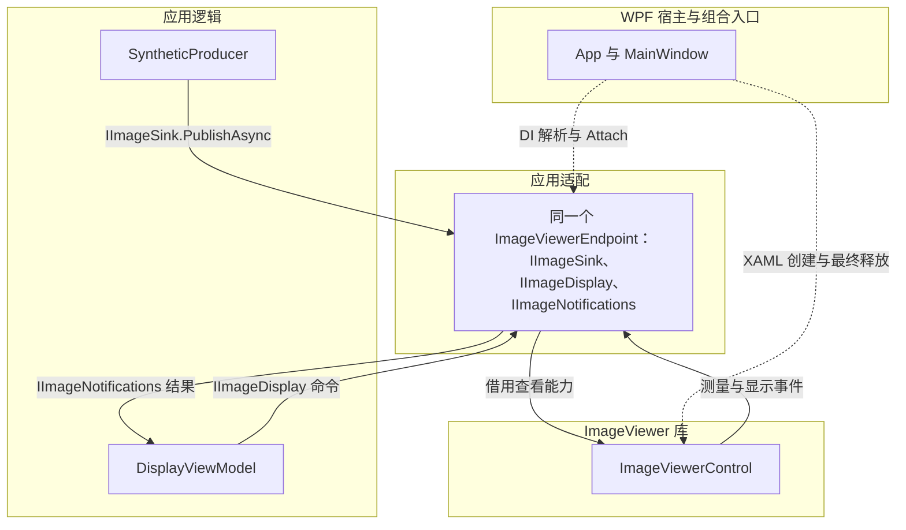
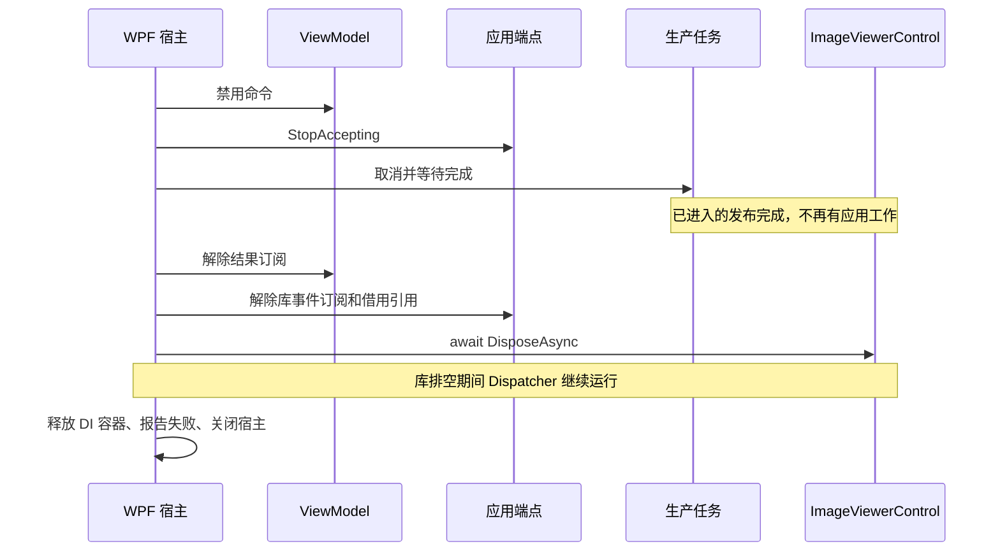

# 通过应用端点集成 ImageViewer

[English](../en/application-integration.md)

当 pipeline、插件或 ViewModel 不应了解窗口、具名控件或 WPF 图像类型时，可使用应用端点。简单窗口直接调用即可，见[嵌入指南](embedding.md)和 [EmbeddedViewer](../../samples/EmbeddedViewer/MainWindow.xaml.cs)。

[ApplicationEndpoint 示例](../../samples/ApplicationEndpoint/App.xaml.cs)是独立 WPF 应用，包含合成 Gray8 帧、两个命令和长度结果绑定。端点、接口和 `Attach` 方法完全属于示例应用，不是 ImageViewer API，也不是所有消费者必须采用的架构。运行不需要插件加载器或处理管线。

## 职责与调用关系

方框分组表示职责归属，实线箭头表示运行时调用或通知，虚线箭头表示组合连接。应用接口不包含 WPF 或 ImageViewer 类型。



| 应用接口 | 用途 |
| --- | --- |
| `IImageSink` | 异步接收拥有所有权的 `GrayFrame`；成功完成表示接收，不表示已呈现。 |
| `IImageDisplay` | 适应图像、启动交互长度测量。 |
| `IImageNotifications` | 传递应用 `LengthResult` 和显示失败消息。 |

`GrayFrame` 只包含宽、高、步长和 `IMemoryOwner<byte>`；`LengthResult` 只包含以图像像素为单位的距离。适配器将内置长度工具的完成事件映射为此结果，不暴露测量句柄、WPF 点或库快照。开始测量是激活工具，不等待用户点击。Escape 取消创建时不会产生完成结果。已完成测量的后续编辑不在这个最小结果契约内。

## 将同一端点注册为多个窄接口

应用使用 `Microsoft.Extensions.DependencyInjection`，不引入托管服务或 MVVM 框架。[App.BuildServices](../../samples/ApplicationEndpoint/App.xaml.cs) 注册一个端点，并将各接口映射到它：

```csharp
services.AddSingleton<ImageViewerEndpoint>();
services.AddSingleton<IImageSink>(
    sp => sp.GetRequiredService<ImageViewerEndpoint>());
services.AddSingleton<IImageDisplay>(
    sp => sp.GetRequiredService<ImageViewerEndpoint>());
services.AddSingleton<IImageNotifications>(
    sp => sp.GetRequiredService<ImageViewerEndpoint>());
services.AddSingleton<SyntheticProducer>();
services.AddSingleton<DisplayViewModel>();
```

如果分别为每个接口注册实现类型，会产生不同实例。这里生产者只接收 `IImageSink`，ViewModel 接收 `IImageDisplay` 和 `IImageNotifications`，不提供面向业务的全能力接口。容器对应这一次显示会话；窗口独立于 DI 拥有控件。

## 连接 XAML 控件

[MainWindow.xaml](../../samples/ApplicationEndpoint/MainWindow.xaml)声明控件，并将按钮和状态绑定到 ViewModel：

```xml
<viewer:ImageViewerControl x:Name="ImageViewer" />
```

[MainWindow.xaml.cs](../../samples/ApplicationEndpoint/MainWindow.xaml.cs) 中的组合入口在 `InitializeComponent()` 后连接：

```csharp
InitializeComponent();
_endpoint = provider.GetRequiredService<ImageViewerEndpoint>();
_endpoint.Attach(ImageViewer);
_viewModel = provider.GetRequiredService<DisplayViewModel>();
DataContext = _viewModel;
```

只有此 View 代码使用具名控件。端点内部借用 `IViewerCapabilities`，从不释放它。宿主在 `Loaded` 后启动后台生产者；布局完成后，通过按钮请求适应图像。不需要依赖属性、控件模板修改或窗口查找。

一个端点只支持一次绑定。绑定前调用抛出 `InvalidOperationException`；`StopAccepting` 后调用抛出应用定义的 `DisplaySessionStoppedException`。重复绑定、停止后绑定以及停止前解除绑定均被拒绝。不等待绑定，也不积压命令。WPF 临时卸载遵循[嵌入契约](embedding.md)，不意味着要解除此端点的绑定或重新绑定。

## 转移缓冲区，避免适配层复制

调用 `PublishAsync` 即转移所有权，包括端点未绑定、已停止、取消或失败。调用后生产者不得修改、复用或释放输入。调用前生成帧失败，仍由生产者清理。

合成生产者为每帧创建普通数组支持的 owner，直接填入像素。适配器使用已有内存和 `GrayFrame.Dispose` 释放回调调用 `ImageFrame.TakeOwnership`，随后提交得到的帧。不增加像素复制、池、缓存、队列或异步转换任务。渲染仍可能需要转换或上传；这里不承诺端到端零复制显示。

| 边界 | 清理责任 |
| --- | --- |
| 调用 sink 前 | 生产者拥有缓冲区。 |
| 未绑定/停止、包装前取消或访问内存失败 | 端点释放应用帧；释放失败与原始错误一起保留。 |
| 调用 `ImageFrame.TakeOwnership` | 即使描述符验证失败，也由库调用释放回调。 |
| 调用 `SubmitFrameAsync` | 所有接收结果均由库消费帧；最后一个引用释放底层存储。 |

owner 必须允许在任意最终释放线程（包括 UI 线程）上非阻塞释放。示例 owner 只是清除数组引用，由 GC 回收内存。以后若使用池或 native owner，也须遵循同一释放契约。

适配器检查提交状态和清理错误。取消转换为 `OperationCanceledException`，其他拒绝状态转换为操作失败。提交错误优先于取消，避免隐藏清理失败。稍后的呈现失败通过独立的显示通知传递。生产者逐次等待接收完成；已接受工作和保留帧由库现有的释放协议排空。

## 线程、结果与失败

生产者在后台任务上运行，逐次等待 sink 调用。绑定、显示命令、通知订阅及解除绑定均在宿主 UI 线程执行；本示例只有帧发布跨越此线程边界。端点用一个小锁协调借用引用和停止标志，不另建提交队列或排空机制。在停止前已取得查看器的发布可以完成；宿主等待生产者结束后才解除绑定。

ImageViewer 在所属 UI 线程传递测量和显示通知。适配器在同一线程同步转发应用值，因此 [DisplayViewModel](../../samples/ApplicationEndpoint/DisplayViewModel.cs) 可以直接更新 `INotifyPropertyChanged` 状态。订阅者应快速返回，不得同步等待 Dispatcher。如果另一个适配器从工作线程发布结果，则必须先调度到 UI，再更新此 ViewModel；这是应用的责任。

命令异常更新绑定状态。宿主在 UI 线程观察生产失败，更新状态并保留任务故障供关闭时报告。显示失败单独更新状态。只有主动关闭期间的取消或特定的会话已停止拒绝视为正常生产结束；其他失败仍可见。

## 按依赖顺序关闭

窗口拥有一个共享清理任务，供启动失败与正常关闭使用。在初始化 XAML 前保留窗口对象，即使启动未到达 `Show()`，也能释放已经创建的控件。



取消第一次 `Closing`；重复关闭请求不会重新清理。等待生产者完成后，宿主解除订阅、等待控件释放并报告失败，再安排本次 `Closing` 回调返回后的最终关闭。不使用 `.Wait()` 或 `.Result` 阻塞 UI。启动和清理失败通过对话框展示；生产任务失败不会阻止控件释放。

端点没有独立转换任务，因此不实现 `DisposeAsync`，也不增加活动调用计数或独立排空任务。宿主已知的生产任务和库的释放完成信号已经足够。单独解除绑定不会释放查看器。控件释放失败应报告，不重试为新会话；库的资源隔离契约仍然有效。后续显示会话需要新端点和新控件。

## 运行与验证

在仓库根目录运行：

```powershell
dotnet run --project samples/ApplicationEndpoint
dotnet test tests/ApplicationEndpoint.Tests -c Release
./scripts/Test-Samples.ps1
```

窗口持续显示移动灰度图案，无需相机或 GPU。点击 **Fit image**，再点击 **Measure length** 并选择两个端点；绑定状态显示像素长度。在流式显示时关闭窗口可验证异步清理。针对性测试覆盖 DI 实例一致性、拒绝与缓冲区释放、取消、包装失败及宿主清理。示例构建本身不执行 WPF 交互。
